# 🎨 Awesome Design & Prototyping

  

  
  
  
  
  
  
  

### 🚀 Curated Guide to Modern UI/UX Design, Interactive Prototyping & Design-to-Code Platforms

*A comprehensive benchmark comparing SaaS market leaders with self-hostable, open-source Figma alternatives.*

---

## 📌 Table of Contents

- [📊 Sector Overview & Market Dynamics](#-sector-overview--market-dynamics)
- [☁️ SaaS / Hosted Platforms](#️-saas--hosted-platforms)
- [🔓 Open-Source GitHub Projects](#-open-source-github-projects)
- [🤝 How to Contribute](#-how-to-contribute)
- [💖 Support & Sponsorship](#-support--sponsorship)
- [📈 Star History](#-star-history)
- [⚠️ Disclaimer](#️-disclaimer)

---

## 📊 Sector Overview & Market Dynamics

The global **UI/UX design and prototyping software market** is currently valued at approximately **$2.0B – $3.0B** (with prototyping-specific software accounting for ~$1.5B – $2.0B) and is expanding rapidly at an estimated **19% – 24% CAGR**.

The market dynamics reflect a **highly concentrated (oligopolistic / winner-takes-most)** structure:
- 👑 **Figma's Dominance**: Figma commands an estimated **80%+ market share** across digital product design teams. This hegemony is reinforced by intense network effects—centralized team libraries, multiplayer design canvases, browser accessibility, and deep developer-handoff ecosystems.
- 🎯 **Market Fragmentation & Niches**: Competing platforms differentiate through specific strategic niches: **Adobe Creative Cloud** captures legacy and enterprise media pipelines, **Sketch** serves macOS-native offline power users, **Framer** leads in direct interactive website publishing, and **Axure RP** dominates logic-heavy, data-driven enterprise prototyping.
- 🌐 **Rise of Open Standards & Self-Hosting**: Increasing enterprise demand for data sovereignty, open SVG/CSS standards, and freedom from proprietary per-seat cloud subscriptions has accelerated adoption of open-source platforms like **Penpot**.

---

## ☁️ SaaS / Hosted Platforms

Below is a detailed benchmark of industry-standard hosted SaaS design and prototyping tools, sorted in descending order by **company size (market cap / valuation / revenue)**:

| Platform | Company Size (Valuation / Revenue) | Pricing (Starting Tier) | Free Tier Limits / Free Trial | Description |
| :--- | :--- | :--- | :--- | :--- |
| **Adobe (Adobe XD)** | ~$95B – $99B Market Cap (~$21B+ Revenue) | $59.99/month (via Creative Cloud All Apps; standalone discontinued) | 7-day free trial of Creative Cloud All Apps (full access during trial); standalone XD free starter tier is discontinued. | UI/UX design and prototyping application integrated within Adobe Creative Cloud; currently in maintenance mode with shifted focus. |
| **Figma** | ~$10B – $13B Valuation / Market Cap (~$1.05B ARR) | $16/full seat/month (billed annually) or $20/month | Free forever: 3 Figma design files, 3 FigJam files, unlimited personal drafts, 1 project, 30-day version history, up to 500 AI credits/mo (no Dev Mode). | The industry-standard multiplayer collaborative interface design, prototyping, and design-system platform. |
| **Framer** | ~$2B Valuation (~$50M – $83M ARR) | $10/site/month (Mini plan, billed annually) or $15/month | Free forever: 1,000 design pages, 10 CMS collections, 5 MB file upload limit, 1 translation locale, up to 3 workspace editors; published on `.framer.app` subdomain with a "Made in Framer" badge. | Interactive UI design and live site publishing tool with built-in CMS, responsive animations, and AI page generation. |
| **InVision** | ~$1.9B – $2.0B Peak Valuation (Acquired/Sunset in 2024; assets sold to Miro) | Discontinued / Sunset ($7.95/user/mo prior to shutdown) | Services fully shut down as of December 31, 2024 (previously offered 1 active prototype on free tier; all user assets deleted). | Historically pioneering digital product design and prototype collaboration platform; ceased operations in late 2024. |
| **Sketch** | ~$1B+ Historical Valuation (~$35M – $40M ARR) | $12/editor/month (billed annually) or $14/month | 30-day free trial with full access to Mac app, web workspace, and collaboration tools; no credit card required. | Native macOS interface design and vector graphics application with extensive plugin ecosystem and shared libraries. |
| **Axure RP** | ~$10M – $25M Estimated Revenue | $25/user/month (Pro plan, billed annually) or $29/month | 30-day free trial of Axure RP 11 with full functionality (unlimited pages, dynamic panels, interactions, conditional logic). | Advanced UX prototyping tool built for complex interactions, conditional logic, dynamic content, and software specifications. |
| **Proto.io** | ~$5M – $10M Estimated Revenue | $24/month (Freelancer plan, billed annually) or $29/month | 15-day free trial with full access to all interactive prototyping features, transitions, and testing tools; no credit card required. | High-fidelity, drag-and-drop interactive prototyping platform designed to produce code-free micro-interactions and mobile animations. |
| **Marvel** | ~$3M – $7M Estimated Revenue | $12/month (Pro plan, billed annually) or $16/month | Free forever: 1 user, 1 active project limit, standard prototyping features and limited user testing. | Simple browser-based wireframing, prototyping, user testing, and developer handoff tool for quick design iterations. |
| **Moqups** | ~$1.2M – $3.7M Estimated Revenue | $8/month (Solo plan, billed annually) or $11/month | Free forever: Up to 2 active projects, 400 objects limit per project, 25 MB image storage, up to 7 view-only collaborators, 2 watermarked exports. | Cloud-based wireframing, diagramming, mockup, and prototype collaboration software for product teams. |

> 💡 **Note on Lunacy (Icons8)**: Proprietary desktop tool with built-in Icons8 assets. Free core app indefinitely (with attribution and 10 cloud docs); paid subscriptions start at $4.99/mo for cloud/team features or $9.99/mo for graphics assets without attribution.

---

## 🔓 Open-Source GitHub Projects

Curated open-source design tools, vector drawing engines, and collaborative prototyping frameworks. Sorted in descending order by **GitHub Stars_Count**:

- **[Excalidraw](https://github.com/excalidraw/excalidraw)**   
  ✏️ **Virtual whiteboard for sketching hand-drawn diagrams** *(MIT License)* — **The whiteboarding choice**. Fun for whiteboarding and rough sketches—hand-drawn aesthetics, real-time collaboration, and an infinite canvas. **Not a design-system tool**: components are limited, and the file format isn't structured enough for production design systems. **Best for**: brainstorming sessions, early-stage wireframing, and flow diagrams—**not production mockups**.

- **[Open Design](https://github.com/nexu-io/open-design)**   
  🤖 **Local-first, agent-native design platform** *(Apache-2.0)* — **The AI-agent-driven choice**. Runs on your own machine with 21+ coding agents supported (Claude Code, Codex, Cursor, Gemini, OpenCode). 129 built-in design systems and 460+ plugins. Generates landing pages, UI prototypes, slides, and production-ready code with local data sovereignty.

- **[Draw.io Desktop](https://github.com/jgraph/drawio-desktop)**   
  📐 **Desktop security-focused diagramming and wireframing application** *(Apache-2.0)* — **The diagramming standard**. Completely offline, cross-platform (Windows, macOS, Linux) wireframing and architecture diagramming application built around mxGraph. Supports extensive UI mockup stencils (iOS, Android, Bootstrap, mockups). **Best for**: technical wireframing, architecture flows, and offline enterprise security.

- **[Penpot](https://github.com/penpot/penpot)**   
  🎨 **The open-source design and prototyping platform for cross-domain teams** *(MPL-2.0)* — **The leading open-source Figma alternative**. Built natively on open web standards: SVG as internal format, CSS Flex and Grid layouts that behave like real code, and HTML/CSS export for developer handoff. Native CSS Grid support lets you define true 12-column layouts without nested hack frames. Inspect tab provides production CSS, SVG, and HTML without paywalls. Self-hostable via Docker Compose.

- **[tldraw](https://github.com/tldraw/tldraw)**   
  🖌️ **Infinite canvas SDK and collaborative whiteboarding library** *(tldraw license / open core)* — **The developer canvas toolkit**. Highly extensible TypeScript library and React canvas component designed for building whiteboards, vector drawing canvases, and interactive diagrams with multiplayer sync out of the box. **Best for**: developers building custom whiteboard and prototyping experiences directly inside web applications.

- **[Flowy](https://github.com/alyssaxuu/flowy)**   
  🔀 **Minimal flowchart and interactive flow engine** *(GPL-3.0)* — **The visual user journey builder**. Lightweight JavaScript flowchart engine for building flowchart and user journey wireframing functionality. Fast drag-and-drop node snapping with custom blocks and interactive flow logic. **Best for**: mapping out multi-step user navigation flows and onboarding journey prototypes.

- **[Pencil Project](https://github.com/evolus/pencil)**   
  📝 **Classic GUI prototyping and desktop wireframing tool** *(GPL-2.0)* — **The offline wireframing veteran**. Mature, dedicated multi-platform GUI prototyping tool providing built-in shape collections for desktop and mobile UI mockups, page linking, and export to HTML, SVG, and PDF. **Best for**: engineers and product managers wanting an offline, lightweight wireframing tool for rapid user flow mockups.

- **[OpenPencil](https://github.com/open-pencil/open-pencil)**   
  📦 **Open-source design editor that reads and writes .fig files natively** *(Open Source)* — **The Figma file migration solution**. Uses the same Kiwi binary codec Figma uses internally—reads and writes `.fig` files natively rather than through a lossy conversion step. Fills, strokes, auto-layout, text, effects, corner radii, and vector networks come through intact. Supports components, variables, auto-layout via flexbox/CSS Grid, and JSX export with Tailwind.

- **[Plasmic](https://github.com/plasmicapp/plasmic)**   
  🧩 **Visual builder and headless CMS for front-end development** *(Open Source core)* — **The code-centric choice**. Positions itself as developer-friendly, connecting visual drag-and-drop design directly into React, Next.js, and Gatsby codebases. **Best for**: teams already invested in React/Next.js wanting visual page building on top of production codebases.

- **[Wireflow](https://github.com/vanila-io/wireflow)**   
  📱 **Open-source wireframe user flow tool** *(Apache-2.0)* — **The rapid user flow mapper**. Lightweight collaborative web tool specifically made for creating user flow wireframes with over 100+ built-in graphic cards for common mobile and web screens, project collaboration, and live brainstorms. **Best for**: agile teams planning UX architecture and screen connections before high-fidelity visual design.

- **[Inkscape](https://github.com/inkscape/inkscape)**   
  ✒️ **Professional vector graphics editor** *(GPL-2.0)* — **The illustration choice**. Solid vector editor on Windows, macOS, and Linux built around standard W3C SVG format. Fundamentally a vector illustration tool rather than a UI/UX screen design tool, but widely used for custom iconography, vector assets, and brand design. **Best for**: logo design, vector asset creation, and illustration.

- **[Quant-UX](https://github.com/KlausSchaefers/quant-ux)**   
  🧪 **Prototyping and automated usability testing platform** *(Apache-2.0)* — **The usability analytics pioneer**. Open-source tool that combines interactive visual prototyping with integrated usability testing and heatmaps. Records user interaction metrics, task completion durations, heatmaps, and screen transitions to evaluate UX designs quantitatively. **Best for**: UX researchers and designers seeking data-driven user testing on interactive prototypes.

- **[Penpot Exporter Figma Plugin](https://github.com/penpot/penpot-exporter-figma-plugin)**   
  🌉 **Figma plugin for migrating files to Penpot** *(MPL-2.0)* — **The migration bridge**. Exports `.fig` files as `.penpot` zip packages for straightforward import into self-hosted or cloud Penpot instances. **Best for**: teams making the Figma-to-Penpot transition.

---

## 🤝 How to Contribute

Contributions are welcome! Please follow these steps:

1. 🍴 Fork the repository.
2. 🌿 Create a descriptive branch: `git checkout -b add-new-design-tool`.
3. 📝 Add or edit entries in `README.md` (keep descriptions factual, include license, and maintain sorting).
4. 🚀 Submit a Pull Request with a short summary of the addition or update.

---

## 💖 Support & Sponsorship

If you found this curated list of design & prototyping tools helpful, please consider showing your support:

- ⭐ **Star this repository** to help others discover it!
- 🍴 **Fork and share** it with your fellow designers, developers, and product teams.
- ☕ **Buy me a coffee / Sponsor the project**: Contributions directly support researching, curating, and maintaining high-quality open-source ecosystem lists. Visit the [GitHub Sponsors Dashboard](https://github.com/sponsors/ishandutta2007) to support!

---

## 📈 Star History

---

## ⚠️ Disclaimer

- This is a **community-curated list** — not exhaustive and not an official commercial endorsement.
- Design tools handling proprietary product designs must be evaluated for **file format portability**, **self-hosting capability**, and **licensing** (open web standards vs. proprietary binary formats).
- **The "Figma replacement" distinction matters for workflow, not just features.** **Penpot** speaks the native language of the web—SVG natively, CSS Flex and Grid as first-class primitives, and HTML/CSS export without plugins. Figma wraps Flexbox in proprietary Auto Layout and charges for Dev Mode. The migration is not just about price—it's about whether your design files are readable outside the vendor's ecosystem.
- **File lock-in is the real switching cost.** `.fig` is Figma's proprietary binary format—nothing else reads it natively without conversion. **OpenPencil** reads `.fig` natively via the Kiwi codec (fills, strokes, auto-layout, text, effects, and vector networks come through intact).
- **Penpot's trade-offs are real.** Whiteboarding requires separate kits (FigJam is more polished), prototyping transitions are simpler than Figma's Smart Animate, and threaded commenting is less refined. For teams prioritizing data sovereignty, open standards, and zero per-seat licensing costs, these are worthwhile trade-offs.
- Self-hosted open-source solutions require proper infrastructure management, backup strategies, and maintenance. Penpot's Docker Compose stack requires PostgreSQL, Valkey, MinIO, and a JVM backend—budget 2+ vCPUs and 4 GB RAM for a smooth production deployment.

---

  <b>Made with ❤️ for product designers, design engineers, and developers building the future of digital interfaces.</b>

